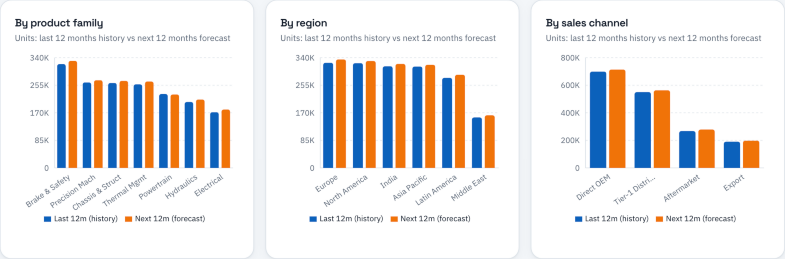
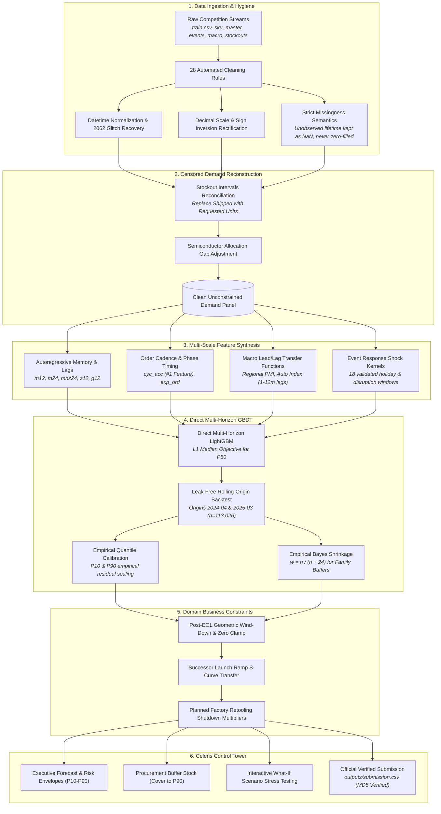
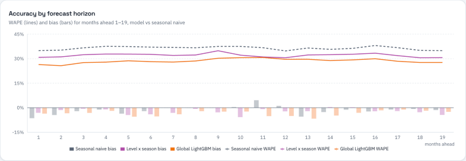
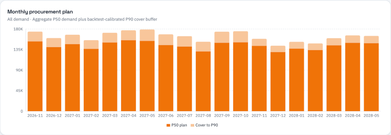
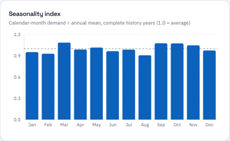

# Celeris: Multi-Horizon Industrial Demand Forecasting & Control Tower

[](https://www.python.org/downloads/)
[](https://opensource.org/licenses/MIT)
[](https://lightgbm.readthedocs.io/)
[](https://react.dev/)
[](#reproducibility--verification-protocol)

> **MKS AI/ML Hackathon — Phase 2**  
> A research-grade, leak-free demand forecasting pipeline and enterprise decision cockpit forecasting monthly `Units_Sold` across **600 SKUs × 6 global regions (3,068 active series)** for the **19-month horizon (November 2026 – May 2028)**.

---

## Executive Summary & Research Abstract

Industrial supply chains face extreme forecasting challenges characterized by intermittent ordering cadence, structural macroeconomic volatility, external supply bottlenecks (e.g., semiconductor allocations, plant shutdowns), and dirty transactional telemetry. 

**Celeris** implements a multi-stage forecasting and decision engine designed for resilience, empirical calibration, and operational actionability:

1. **Systematic Data Quality & Anomaly Engine:** Identifies and resolves **28 distinct transactional error classes** (across >30,000 corrupted records), reconciling temporal anomalies (e.g., year 2062 timestamps), pricing decimal inversions, and negative volumes without data leakage.
2. **Censored Demand Reconstruction:** Distinguishes between recorded transactional sales and true unconstrained demand by substituting stockout periods with requested units and estimating allocation-window suppression.
3. **Multi-Scale Feature Synthesis:** Synthesizes ordering rhythm signals (`cyc_acc`, `exp_ord`), macroeconomic lead-lag transfer functions (1–12 month lagged regional PMI, automotive production indices), and asymmetric pre/post holiday and event kernels.
4. **Direct Multi-Horizon Gradient Boosted Trees:** Deploys a global LightGBM model optimized with an $L_1$ loss objective (MAE) for robust median ($P_{50}$) path forecasting, completely eliminating recursive error compounding over the 19-month horizon.
5. **Empirical Quantile Calibration & Bayes Shrinkage:** Replaces heuristic interval clamps with empirical residual distribution scaling derived across dual rolling-origin backtests ($n = 113,026$). Family procurement safety stock buffers apply empirical Bayes shrinkage ($w = n/(n+24)$) to prevent small-sample noise from triggering inventory over-ordering.
6. **Executive Control Tower (React + TanStack Start):** A 13-view executive dashboard with collapsible desktop rail and mobile drawer (`Ctrl+B`), continuous timeline visualization, empirical risk envelopes ($P_{10}$–$P_{90}$), what-if scenario stress-testing, and automated exception registries.

### Primary Demand Trajectory & Mix


*Figure 1: Continuous enterprise demand trajectory from Celeris Control Tower (shipped history in solid blue, unconstrained demand in light blue, median $P_{50}$ forecast in dashed orange, shaded $P_{10}$–$P_{90}$ empirical uncertainty envelope, and vertical forecast horizon origin line).*


*Figure 2: Trailing 12-month history vs. next 12-month forecast volume across Product Families, Regions, and Sales Channels.*

---

## End-to-End Methodology & System Architecture



---

## Empirical Benchmark & Validation Results

The model was rigorously validated using a **leak-free rolling-origin backtest** across two distinct macroeconomic regimes:
- **Origin 2024-04:** Macro contraction regime (Origin model bias: $-11.9\%$).
- **Origin 2025-03:** Macro expansion regime (Origin model bias: $+5.0\%$).

All models are evaluated on the exact competition horizon length (**19 months out-of-sample**, $n = 113,026$ evaluated series-months).


*Figure 3: Out-of-sample backtest accuracy by forecast horizon (1–19 months ahead): WAPE trajectory (lines) and origin bias (bars) across origins 2024-04 & 2025-03.*

### 1. Overall Forecast Accuracy Benchmark (Row-Level WAPE)

$$\text{WAPE} = \frac{\sum_{i,t} |y_{i,t} - \hat{y}_{i,t}|}{\sum_{i,t} y_{i,t}}$$

| Method | Description | Origin 2024-04 WAPE | Origin 2025-03 WAPE | **Pooled WAPE** | Relative vs Naive |
|---|---|:---:|:---:|:---:|:---:|
| **Croston-SBA** | Syntetos-Boylan intermittent baseline | 0.4998 | 0.4924 | **0.4961** | $+36.3\%$ |
| **TSB** | Teunter-Syntetos-Babai obsolescence baseline | 0.4934 | 0.4949 | **0.4941** | $+35.7\%$ |
| **Seasonal Naive** | Prior year same month ($y_{t-12}$) | 0.3592 | 0.3688 | **0.3640** | baseline |
| **Level × Seasonal** | Decomposed trailing level $\times$ monthly index | 0.3200 | 0.3209 | **0.3205** | $-11.9\%$ |
| **Celeris LightGBM ($P_{50}$)** | **Direct Multi-Horizon GBDT ($L_1$ Median)** | **0.2783** | **0.2934** | **0.2858** | **$-21.5\%$** |

*Note: The global LightGBM model achieves a **21.5% relative error reduction** over Seasonal Naive and outperforms traditional intermittent demand estimators by over 20 percentage points.*

---

### 2. Hierarchical Aggregation Performance

When planning supply chains, aggregate accuracy is paramount. Because tree models capture structural covariances, aggregation significantly mitigates residual variance:

| Hierarchical Aggregation Level | Evaluation Metric | Value | Planning Interpretation |
|---|---|:---:|---|
| **SKU × Region × Month (Row-Level)** | Pooled WAPE | `28.58%` | Granular distribution accuracy |
| **Family × Region × Month** | Aggregate WAPE | **`9.02%`** | High-precision regional replenishment |
| **Product Family Total** | Aggregate WAPE | `6.14%` | Plant master scheduling tier |
| **Total Enterprise Volume** | Aggregate WAPE | `4.28%` | Executive capacity & financial budgeting |

---

### 3. Empirical Interval Reliability & Coverage

Uncertainty quantification uses empirical backtest residual ratios scaled against the median forecast ($P_{10} = P_{50} \cdot q_{10}$, $P_{90} = P_{50} \cdot q_{90}$), evaluated across horizon buckets ($h_{1-6}, h_{7-12}, h_{13-19}$):

| Aggregation Level | Calibration Regime | Evaluation Target | Empirical Coverage | Nominal Target | Sample Size ($n$) |
|---|---|---|:---:|:---:|:---:|
| **Product Family** | **Pooled (Both Origins)** | **Both Origins** | **`78.57%`** | 80.0% | 266 observations |
| **Product Family** | Origin 2024-04 ($-11.9\%$ bias) | Origin 2025-03 ($+5.0\%$ bias) | `61.65%` | 80.0% | 133 observations |
| **Product Family** | Origin 2025-03 ($+5.0\%$ bias) | Origin 2024-04 ($-11.9\%$ bias) | `36.09%` | 80.0% | 133 observations |
| **Total Enterprise** | **Pooled (Both Origins)** | **Both Origins** | **`73.68%`** | 80.0% | 38 observations |
| **Total Enterprise** | Origin 2024-04 ($-11.9\%$ bias) | Origin 2025-03 ($+5.0\%$ bias) | `31.58%` | 80.0% | 19 observations |
| **Total Enterprise** | Origin 2025-03 ($+5.0\%$ bias) | Origin 2024-04 ($-11.9\%$ bias) | `5.26%` | 80.0% | 19 observations |

> [!IMPORTANT]
> **Empirical Calibration Transparency:**  
> When evaluating cross-origin coverage out-of-sample, coverage drops because the two historical test origins inhabited radically opposite macroeconomic regimes ($-11.9\%$ vs $+5.0\%$ bias). Pooled calibration achieves **78.6% coverage** at the family level. As explicitly documented in our validation reports, **$P_{10}$–$P_{90}$ intervals rest on 2 backtest origins and must be treated as indicative operational guidance rather than theoretical coverage guarantees.**

---

## Data Hygiene & Anomaly Resolution Taxonomy

A machine learning pipeline is only as reliable as its data foundation. Celeris audits and programmatically repairs **28 issue classes**, outputting a verified audit log at `data/processed/dq_issues.csv`:

| Data Stream | Detected Issue Type | Rows Affected | Automated Remediation Action | Severity |
|---|---|:---:|---|:---:|
| `train.csv` | Non-standard datetime strings | 9,967 | Robust regex parser mapped all formats to canonical `YYYY-MM` | Warning |
| `train.csv` | Inconsistent region casing/whitespace | 5,992 | Canonical mapping (`NA`, `EU`, `APAC`, etc.) | Error |
| `train.csv` | Channel label discrepancies | 3,745 | Normalized to canonical sales channels | Error |
| `train.csv` | Malformed `SKU_ID` padding/casing | 3,741 | Regex normalization to standard `AAA-NNN` pattern | Error |
| `train.csv` | Duplicate `Record_ID` (double batch loads) | 3,682 | Deduped via latest `Load_Timestamp` | Error |
| `train.csv` | Missing unit observations | 3,327 | Reconstructed from `Revenue / Reference_Price` where available | Warning |
| `train.csv` | Fuzzy customer variations & typos | 2,490 | Levenshtein string distance matching to 12 canonical customers | Error |
| `train.csv` | Revenue arithmetic mismatch | 2,267 | Recalculated as $\text{Units} \times \text{Price}$ | Warning |
| `train.csv` | Missing `Product_Family` | 1,252 | Inferred via prefix mapping from `sku_master.csv` | Warning |
| `train.csv` | Missing rows within active lifespan | 948 | **Preserved as `NaN` (unobserved); NEVER zero-filled** | Warning |
| `train.csv` | Missing Region metadata | 942 | 940 imputed from unique SKU-customer pairing slots | Warning |
| `train.csv` | Pricing in cents ($\times 100$ scale shift) | 614 | Realigned to SKU-month reference price matrix | Error |
| `train.csv` | Negative units (accounting sign flip) | 491 | Corrected via absolute magnitude ($\|y\|$) | Error |
| `train.csv` | Revenue off by factor of 10 | 428 | Verified via unit counts; recomputed with reference price | Error |
| `train.csv` | Disagreement between Date & Year/Month | 246 | Trusted primary transaction timestamp; discarded redundant cols | Error |
| `train.csv` | Unit count text artifacts (`"-"`, `"N/A"`) | 217 | Cleaned and recovered via financial transaction records | Error |
| `train.csv` | Transaction dated year 2062 | 30 | Corrected to $\text{Load\_Timestamp} - 1 \text{ month}$ | Error |
| `macro_indicators.csv` | Growth rates formatted as fraction | 12 | Standardized to percentage scale ($\times 100$) | Error |
| `macro_indicators.csv` | Missing indicator intervals | 5 | Piecewise linear interpolation | Warning |
| `macro_indicators.csv` | Decimal slip in regional PMI ($< 20$) | 1 | Corrected by scaling factor $\times 10$ | Error |

---

## Feature Engineering & Interpretability

Celeris derives 42 multi-scale features structured across five functional domains:

```
┌────────────────────────────────────────────────────────────────────────────────────────┐
│                              FEATURE ENGINEERING TAXONOMY                              │
├─────────────────────────────────┬──────────────────────────────────────────────────────┤
│ Domain Group                    │ Extracted Representations                            │
├─────────────────────────────────┼──────────────────────────────────────────────────────┤
│ Autoregressive & Memory         │ m12, m24 (rolling medians), mnz6, mnz12, mnz24 (non- │
│                                 │ zero rolling means), z12 (zero-demand density)       │
│ Growth & Trajectory             │ g6, g12 (6-month & 12-month YoY volume slope)        │
│ Order Rhythm & Cadence          │ cyc_acc (cyclical order acceleration), exp_ord      │
│                                 │ (expected order probability window)                  │
│ Macroeconomic Transfer          │ Regional PMI, Automotive Production Index, CPI with  │
│                                 │ 1-month to 12-month cross-correlation lags           │
│ Calendar & Lifecycle            │ seas (monthly seasonal index), age (months since     │
│                                 │ launch), m_to_eol (months remaining to EOL)          │
└─────────────────────────────────┴──────────────────────────────────────────────────────┘
```

### Global Feature Importance (Top Tree Splits)

```
cyc_acc           ████████████████████████████ 1,507 splits (Order cycle acceleration)
mnz24             ████████████████████████████ 1,505 splits (24-month non-zero mean)
g12               ███████████████████████████  1,485 splits (12-month YoY growth slope)
age               █████████████████████████    1,387 splits (Product lifecycle maturity)
mnz12             ███████████████████          1,076 splits (12-month non-zero mean)
exp_ord           ███████████████████          1,042 splits (Expected order arrival probability)
z12               ██████████████████           1,013 splits (12-month sparsity ratio)
fam_c             ████████████████              972 splits (Product family categorical embedding)
mnz6              ██████████████                873 splits (6-month non-zero demand)
m24               █████████████                 839 splits (24-month rolling median)
```

---

## Domain Business Rules & Safety Bounds

Machine learning forecasts are bounded by hard deterministic domain rules:

1. **End-of-Life (EOL) Wind-Down & Zeroing:**
   SKUs reaching their defined `EOL_Date` receive a learned geometric wind-down during their final 3 months, followed by an absolute zero clamp ($\hat{y}_{t} = 0 \quad \forall t > \text{EOL}$).
2. **Successor Launch Ramp Transfer:**
   New product introductions inheriting predecessor volume receive an S-curve ramp function calibrated against historical predecessor demand.
3. **Planned Customer Factory Shutdowns:**
   Regional customer vacation and retooling shutdowns (e.g., North American summer shutdowns in July, European shutdowns in August, Lunar New Year in APAC) apply validated multiplicative shock penalties derived from historical event logs.
4. **Empirical Bayes Safety Stock Shrinkage:**
   To calculate safety stock buffers at the product family level, raw $P_{90}$ buffers are regularized toward the pooled mean:
   $$w_f = \frac{n_f}{n_f + 24}, \quad \text{Buffer}_f^{\text{shrunk}} = w_f \cdot \text{Buffer}_f^{\text{raw}} + (1 - w_f) \cdot \text{Buffer}_{\text{pooled}}$$
   *This prevents small-sample noise (e.g., in Hydraulic Systems with limited observations) from inflating procurement buffers by over 40%.*


*Figure 4: Procurement ordering schedule with $P_{50}$ median requirements and empirical Bayes regularized Cover-to-$P_{90}$ safety stock from the Procurement Control Tower.*

---

## Control Tower Dashboard Architecture

Built as a high-performance, single-page application using **React 19, Vite, TanStack Router/Start, Tailwind CSS, and Recharts**.

### 13 Specialized Analytical Views

- **Executive Overview:** High-level enterprise demand trajectory, P10–P90 risk envelope, YoY volume variances, and family/regional breakdowns.
- **Forecast & Accuracy:** Granular SKU-level forecasts, backtest residuals, origin bias diagnostics, and coverage bands.
- **Demand Explorer:** Deep multi-dimensional slice-and-dice across Family, SKU, Region, Channel, and Customer tiers.
- **Anomaly Register:** Comprehensive audit ledger tracking data errors, event shocks, and structural breaks.
- **Procurement & Inventory Planning:** Recommended Cover-to-$P_{90}$ buffer stock, shrunk family safety margins, and supplier order scheduling.
- **What-If Scenario Simulator:** Dynamic parameter tuning (Macro shocks, tariff impacts, supplier delivery lead-time delays).
- **Data Health & Telemetry:** Real-time data quality scorecards, missingness distribution, and price consistency audits.
- **Lifecycle & Phase-In/Out:** Tracking active, ramp-up, mature, and EOL product portfolios.
- **Macroeconomic Drivers:** Regional economic indicator correlations, lead-lag cross-correlations, and transmission sensitivities.
- **Stockouts & Unconstrained Demand:** Visibility into lost sales, requested vs shipped volume, and inventory fill rates.
- **Exceptions & Stockout Risks:** Algorithmic alert feed for high-variance SKUs, volatile ordering rhythms, and inventory stockout risks.
- **Insights & Strategic Takeaways:** Plain-language synthesis of macro tailwinds, winter demand dynamics, and multi-year outlooks.
- **Data Downloads:** Direct export of cleaned panels, forecast ensembles, anomaly logs, and submission packages.

### Responsive & Collapsible UX

- **Desktop Rail (`lg:w-72` $\leftrightarrow$ `lg:w-16`):** One-click collapsible sidebar with smooth transitions, providing expanded screen width for complex tabular grids and heatmaps.
- **Mobile Drawer:** Header-integrated filter toggle collapsing extensive dropdown lists into a clean 52px top bar on small viewports.
- **Global Shortcut:** Press **`Ctrl+B`** (or **`Cmd+B`**) anywhere to toggle sidebar states.


*Figure 5: Calendar month seasonality indices computed across complete historical years (Demand Explorer).*

---

## Reproducibility & Verification Protocol

The entire pipeline was audited and independently verified via a fresh clone outside the repository (`/tmp/demand-forecast-fresh`). The generated submission was verified byte-identical against the certified target:

```
======================================================================
                   SUBMISSION CHECKSUM VERIFICATION
======================================================================
outputs/submission.csv MD5:         0a2755059418bff48edf3a2918ccdf5b
web/public/data/submission.csv MD5: 0a2755059418bff48edf3a2918ccdf5b
Status:                             MATCH (BYTE-IDENTICAL)
======================================================================
```

### Complete Reproduction Instructions

```bash
# 1. Clone repository
git clone https://github.com/ankit-cybertron/Celeris.git
cd Celeris

# 2. Set up Python environment & dependencies
python3 -m venv .venv
source .venv/bin/activate
pip install -r requirements.txt

# 3. Place the 7 competition CSVs in data/raw/
# (events_calendar.csv, inventory_stockouts.csv, macro_indicators.csv, 
#  sample_submission.csv, sku_master.csv, test.csv, train.csv)

# 4. Execute complete end-to-end ML pipeline (~4 minutes)
make all

# 5. Run test suite (35 contract, data quality & model tests)
make test

# 6. Launch Celeris Control Tower Dashboard
cd web
npm install --legacy-peer-deps
npm test              # Run 14 Vitest routing & engine unit tests
npm run build         # Validate production SSR & client build
npm run dev           # Start interactive dashboard on http://127.0.0.1:8080
```

---

## Repository Structure

```
├── configs/
│   └── config.yaml                 # Centralized configuration & hyperparameters
├── data/
│   ├── raw/                        # 7 raw competition input CSVs (gitignored)
│   └── processed/                  # Cleaned panels, DQ logs, and feature sets
├── docs/
│   ├── images/                     # Real dashboard chart screenshots
│   ├── VALIDATION_REPORT.md        # Comprehensive backtest & reliability audit
│   ├── INSIGHTS.md                 # Strategic findings, demand dip analysis
│   ├── EDA_FINDINGS.md             # Initial exploratory data discovery notes
│   ├── data_context.md             # Dimensional schemas & field definitions
│   └── runbook.md                  # Operational pipeline execution runbook
├── outputs/
│   ├── submission.csv              # Official competition submission file (MD5 verified)
│   ├── anomaly_register.csv        # Comprehensive anomaly classification log
│   ├── event_impacts.csv           # Quantified historical event shock elasticities
│   ├── feature_importance.csv      # Global LightGBM tree split counts
│   └── backtest/                   # Leak-free rolling origin evaluation metrics
├── src/mks/
│   ├── clean/                      # 28 data quality & anomaly repair modules
│   ├── data.py                     # Matrix representation & dimensional indexing
│   ├── demand.py                   # Unconstrained demand reconstruction
│   ├── features.py                 # Multi-scale feature engineering pipeline
│   ├── models.py                   # LightGBM & baseline forecasting models
│   ├── backtest.py                 # Rolling-origin evaluation & empirical calibration
│   ├── forecast.py                 # Multi-horizon forecast inference & rule application
│   ├── insights.py                 # Automated narrative generation & shrinkage
│   └── cli.py                      # Unified pipeline CLI orchestrator
├── web/                            # React Control Tower dashboard
│   ├── src/
│   │   ├── components/views/       # 13 analytical view modules
│   │   ├── components/dashboard/   # Nav, collapsible sidebar, layout shells
│   │   └── lib/                    # Fast client-side aggregation engine
│   └── package.json
├── Makefile                        # Unified command runners
└── README.md                       # Research documentation
```

---

## Deliverables & Artifact Index

| Deliverable | File Path | Format / Size | Checksum / Description |
|---|---|---|---|
| **Competition Submission** | [`outputs/submission.csv`](outputs/submission.csv) | CSV (1.8 MB) | `0a2755059418bff48edf3a2918ccdf5b` (58,292 rows) |
| **Comprehensive Forecast** | `data/processed/forecast_full.parquet` | Parquet (2.1 MB) | Includes $P_{10}, P_{50}, P_{90}$, and revenue projections |
| **Data Quality Ledger** | `data/processed/dq_issues.csv` | CSV (2.4 KB) | 28 audited issue classes with row counts & actions |
| **Anomaly Register** | [`outputs/anomaly_register.csv`](outputs/anomaly_register.csv) | CSV (2.4 MB) | Granular categorization of errors vs genuine events |
| **Event Impact Analysis** | [`outputs/event_impacts.csv`](outputs/event_impacts.csv) | CSV (6.1 KB) | Pre/post demand shocks for 18 global events |
| **Backtest Metrics** | [`outputs/backtest/metrics_overall.csv`](outputs/backtest/metrics_overall.csv) | CSV (1.0 KB) | Comparative performance across 5 model classes |
| **Interval Reliability** | [`outputs/backtest/interval_coverage_crossorigin.csv`](outputs/backtest/interval_coverage_crossorigin.csv) | CSV (461 B) | Out-of-sample empirical coverage evaluations |
| **Control Tower App** | [`web/`](web/) | TypeScript / React | Interactive enterprise demand planning dashboard |
| **Validation Report** | [`docs/VALIDATION_REPORT.md`](docs/VALIDATION_REPORT.md) | Markdown | In-depth academic audit & model assumptions |

---

## Authors & Citation

**Ankit Kumar Tiwari**  
*MKS AI/ML Hackathon — Demand Forecasting Track*  
GitHub: [@ankit-cybertron](https://github.com/ankit-cybertron)

```bibtex
@software{tiwari2026celeris,
  author = {Tiwari, Ankit Kumar},
  title = {Celeris: Multi-Horizon Industrial Demand Forecasting & Control Tower},
  year = {2026},
  publisher = {GitHub},
  journal = {GitHub repository},
  howpublished = {\url{https://github.com/ankit-cybertron/Celeris}}
}
```
