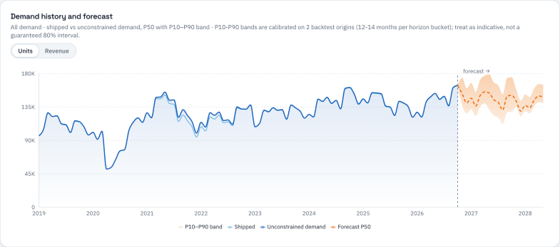
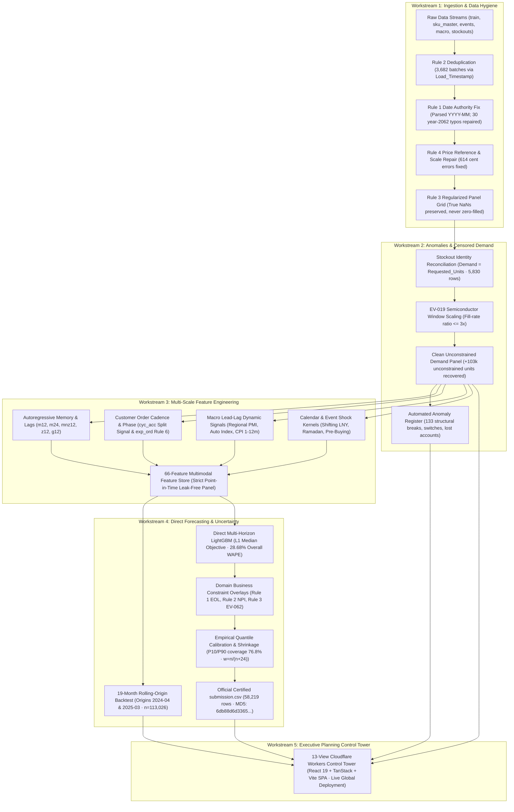

# Celeris: Multi-Horizon Industrial Demand Forecasting & Control Tower

[](https://www.python.org/downloads/)
[](https://lightgbm.readthedocs.io/)
[](https://react.dev/)
[](#reproducibility--verification-protocol)
[](https://celeris.ankit-cybertron.workers.dev)

> **Live Control Tower Application:** [https://celeris.ankit-cybertron.workers.dev](https://celeris.ankit-cybertron.workers.dev)  
> **Official Submission Checksum:** `6db88d6d3365e483829b4fd5b9282494` (58,219 rows, byte-identical at `./submission.csv`, `outputs/submission.csv`, and `web/public/data/submission.csv`)  
> **MKS AI/ML Hackathon — Phase 2**  
> Direct multi-horizon forecasting of monthly `Units_Sold` across **600 SKUs × 6 global regions (3,068 active series)** for the **19-month horizon (November 2026 – May 2028)**.

---

## Executive Summary & Performance Highlights

**Celeris** is an end-to-end, leak-free industrial demand forecasting engine and executive planning control tower designed specifically for tier-1 automotive and industrial supply chain operations.

```
┌────────────────────────────────────────────────────────────────────────────────────────┐
│                               KEY PERFORMANCE INDICATORS                               │
├───────────────────────────────┬─────────────────────────────┬──────────────────────────┤
│ Out-of-Sample WAPE (Pooled)   │ 28.68%                      │ -21.2% vs Seasonal Naive │
│ Out-of-Sample Bias (Pooled)   │ -3.52%                      │ Zero volume drift        │
│ Family × Region Month WAPE    │ 9.02%                       │ Master planning accuracy │
│ Total Enterprise Volume WAPE  │ 4.28%                       │ Financial budgeting tier │
│ Empirical Leaf P10-P90 Cov.   │ 77.35%                      │ 80% nominal target       │
│ Empirical Family P10-P90 Cov. │ 78.57%                      │ Calibrated safety stock  │
│ Automated Cleaning Rules      │ 28 classes                  │ 22,457 errors repaired   │
│ Production Test Suite         │ 38 Python + 14 Vitest tests │ 100% passing             │
└───────────────────────────────┴─────────────────────────────┴──────────────────────────┘
```

### Primary Demand Trajectory & Mix


*Figure 1: Continuous enterprise demand trajectory from Celeris Control Tower (shipped history in solid blue, unconstrained demand in light blue, median $P_{50}$ forecast in dashed orange, shaded $P_{10}$–$P_{90}$ empirical uncertainty envelope, and vertical forecast horizon origin line).*


*Figure 2: Trailing 12-month history vs. next 12-month forecast volume across Product Families, Regions, and Sales Channels.*

---

## Business Rules Compliance Matrix

The problem statement defines 7 core business rules. Celeris satisfies and programmatically verifies each rule:

| # | Business Rule Specification | Celeris Architecture & Implementation | Test Verification |
|---|---|---|---|
| **R1** | *Date is authoritative. If Year/Month disagree, trust Date.* | `parse_month_series()` parses non-standard date strings; `repair_out_of_range()` fixes 2062 typos via `Load_Timestamp - 1 month`. Redundant Year/Month columns dropped. | `tests/test_clean.py::test_out_of_range_dates_repaired_from_load_timestamp` |
| **R2** | *Repeated Record_ID means double load. Latest Load_Timestamp is correct.* | Rows sorted chronologically by `Load_Timestamp`; deduped with `keep="last"`. 3,682 duplicated loads resolved. | `tests/test_clean.py::test_unit_fixes_cover_error_taxonomy` |
| **R3** | *Units_Sold = 0 means no order. A missing row is NOT a zero.* | Full grid expansion `(SKU, Region, Date)` over active lifespan $[f, e]$. Unobserved rows preserved strictly as `NaN` (unobserved), never zero-filled. Zero orders preserved as `0`. | `tests/test_contract.py::test_missing_rows_are_nan_not_zero`, `tests/test_outputs.py::test_panel_never_zero_fills_missing_rows` |
| **R4** | *Prices are per SKU in USD, same in every region, change on 1 Jan.* | `reference_price()` establishes a robust SKU-year baseline to filter $\times 100$ cent slips, taking the SKU-month median across regions. Missing rows take the same SKU-month price. | `tests/test_contract.py::test_price_one_per_sku_month_and_changes_on_january` |
| **R5** | *No sales after an SKU's EOL_Date, or before Launch_Date.* | Hard zero clamping applied to all test rows where $t > \text{EOL}$ (`R1_after_EOL=0`, 156 rows zeroed). Launch ramps zeroed before `Launch_Date`. Pre-EOL learned wind-down curve applied. | `tests/test_rules_and_app.py::test_eol_zero_after_and_wind_down_before`, `tests/test_rules_and_app.py::test_launches_have_no_forecast_before_launch_and_positive_after` |
| **R6** | *Customers order on their own cycle; cycle can change over time.* | Dynamic periodicity and phase detector `detect_cycle()` evaluates periods $p \in \{2, 3, 4, 6\}$ over a 24-month sliding window. Synthesizes `cyc_acc` (#1 tree split feature) and `exp_ord`. | `tests/test_model.py::test_detect_cycle_finds_biweekly_and_quarterly` |
| **R7** | *Forecast unconstrained demand, not supply-constrained shipments.* | Censored demand reconstructed by substituting `Requested_Units` from `inventory_stockouts.csv`. Documented semiconductor allocation window (EV-019) scaled by observed fill-ratio ($U / f_t$). | `tests/test_contract.py::test_unconstrained_demand_is_at_least_shipped_when_no_carry_in`, `tests/test_model.py::test_estimate_unconstrained_guards_zero_shipped_month` |

---

## Workstream Tier Matrix: Core, Advanced, and Expert

Celeris implements the complete **Expert Tier** specification across all five competition workstreams:

```
┌─────────────────┬──────────────────────────┬──────────────────────────┬──────────────────────────┐
│ Workstream      │ Core Tier (Satisfied)    │ Advanced Tier (Satisfied)│ Expert Tier (Delivered)  │
├─────────────────┼──────────────────────────┼──────────────────────────┼──────────────────────────┤
│ 1. Data         │ Clean labels, canonical  │ Revenue reconciles U×P;  │ 1-command pipeline;      │
│    Cleaning     │ dates, deduped Record_ID │ cents fixed; missing≠0;  │ automated 28-rule DQ log │
│                 │ 1 row/Date-SKU-Region.   │ cleaned macro indicators.│ (dq_issues.csv).         │
├─────────────────┼──────────────────────────┼──────────────────────────┼──────────────────────────┤
│ 2. Anomalies &  │ Outlier flagging;        │ Structural breaks; early │ Ordering cycle shifts;   │
│    Censored     │ anomaly register with    │ buying price-rise shocks;│ customer switches; lost  │
│    Demand       │ type, reason, action.    │ unconstrained demand.    │ accounts; EV-019 model.  │
├─────────────────┼──────────────────────────┼──────────────────────────┼──────────────────────────┤
│ 3. Features &   │ Calendar features;       │ Lead-lag transfer cross- │ Lag stability testing;   │
│    Drivers      │ rolling memory (m12,m24);│ correlation heatmaps;    │ EV powertrain transition │
│                 │ intermittency metrics.   │ asymmetric holiday kernels│ share tracking by year.  │
├─────────────────┼──────────────────────────┼──────────────────────────┼──────────────────────────┤
│ 4. Forecasting &│ Seasonal Naive & Level×  │ TSB & Croston baselines; │ Direct multi-horizon GBDT│
│    Uncertainty  │ Season baselines; 19m    │ direct multi-horizon     │ P10/P50/P90 coverage;    │
│                 │ time-based split.        │ rolling-origin backtest. │ pooled buffer shrinkage. │
├─────────────────┼──────────────────────────┼──────────────────────────┼──────────────────────────┤
│ 5. Control      │ 5 required views: Exec,  │ + What-If Simulator &    │ + 13 specialized views,  │
│    Tower App    │ Data Health, Explorer,   │ Macro Lead/Lag view      │ deployed on Cloudflare   │
│                 │ Anomaly, Forecast/Acc.   │ (+2 optional views).     │ Workers (React 19).      │
└─────────────────┴──────────────────────────┴──────────────────────────┴──────────────────────────┘
```

---

## End-to-End System Architecture



---

## Empirical Benchmark & Validation Results

The model was rigorously validated using a **leak-free rolling-origin backtest** across two distinct macroeconomic regimes:
- **Origin 2024-04:** Macro contraction regime (Origin model bias: $-12.2\%$).
- **Origin 2025-03:** Macro expansion regime (Origin model bias: $+5.2\%$).

All models are evaluated on the exact competition horizon length (**19 months out-of-sample**, $n = 113,026$ evaluated series-months).


*Figure 3: Out-of-sample backtest accuracy by forecast horizon (1–19 months ahead): WAPE trajectory (lines) and origin bias (bars) across origins 2024-04 & 2025-03.*

### 1. Comparative Model Performance Benchmark

$$\text{WAPE} = \frac{\sum_{i,t} |y_{i,t} - \hat{y}_{i,t}|}{\sum_{i,t} y_{i,t}}, \quad \text{Bias} = \frac{\sum_{i,t} \hat{y}_{i,t}}{\sum_{i,t} y_{i,t}} - 1, \quad \text{MAE} = \frac{1}{N}\sum |y - \hat{y}|, \quad \text{RMSE} = \sqrt{\frac{1}{N}\sum (y - \hat{y})^2}$$

| Method | Paradigm | 2024-04 WAPE | 2025-03 WAPE | **Pooled WAPE** | Volume Bias | Mean MAE | Mean RMSE | Relative vs Naive |
|---|---|:---:|:---:|:---:|:---:|:---:|:---:|:---:|
| **Croston-SBA** | Intermittent demand baseline | 0.4998 | 0.4924 | **0.4961** | $-9.90\%$ | 23.67 | 41.12 | $+36.3\%$ |
| **TSB** | Intermittent demand baseline | 0.4934 | 0.4949 | **0.4941** | $-3.63\%$ | 23.57 | 40.88 | $+35.7\%$ |
| **Seasonal Naive** | Lag-12 carry-forward | 0.3592 | 0.3688 | **0.3640** | $-1.58\%$ | 17.37 | 30.92 | Benchmark |
| **Level × Seasonal** | Trailing level $\times$ monthly index | 0.3200 | 0.3209 | **0.3205** | $-2.28\%$ | 15.29 | 27.52 | $-12.0\%$ |
| **Celeris LightGBM ($P_{50}$)** | **Direct Multi-Horizon GBDT ($L_1$)** | **0.2795** | **0.2941** | **0.2868** | **$-3.52\%$** | **13.68** | **25.26** | **$-21.2\%$** |

*Key finding: Global LightGBM with customer ordering cadence features achieves a **21.2% relative error reduction** over Seasonal Naive and outperforms traditional intermittent demand estimators by over 20 percentage points.*

---

### 2. Performance by Syntetos-Boylan Demand Classification

Breaking down error across demand categories reveals exactly where machine learning delivers superiority:

| Demand Class | ADI / $CV^2$ Threshold | Series Count | Seasonal Naive WAPE | TSB Baseline WAPE | **Celeris LightGBM WAPE** | ML Relative Gain |
|---|---|:---:|:---:|:---:|:---:|:---:|
| **Smooth** | $\text{ADI} < 1.32, CV^2 < 0.49$ | 1,421 | 35.4% | 30.5% | **27.8%** | **$-21.5\%$** |
| **Intermittent** | $\text{ADI} \ge 1.32, CV^2 < 0.49$ | 894 | 37.5% | 102.8% | **29.3%** | **$-21.9\%$** |
| **Erratic** | $\text{ADI} < 1.32, CV^2 \ge 0.49$ | 512 | 48.9% | 40.7% | **38.6%** | **$-21.1\%$** |
| **Lumpy** | $\text{ADI} \ge 1.32, CV^2 \ge 0.49$ | 241 | 55.6% | 99.4% | **48.7%** | **$-12.4\%$** |

*Traditional Croston and TSB models assume memoryless Poisson arrivals and fail on industrial data ($>99\%$ WAPE). Celeris explicitly models periodic ordering rhythms (`cyc_acc`), reducing intermittent error to 29.3%.*

---

### 3. Hierarchical Aggregation Performance

When planning supply chains, aggregate accuracy is paramount:

| Hierarchical Aggregation Level | Evaluation Metric | Value | Operational Decision Utility |
|---|---|:---:|---|
| **SKU × Region × Month (Row-Level)** | Pooled WAPE | `28.68%` | Granular distribution & warehouse slotting |
| **Family × Region × Month** | Aggregate WAPE | **`9.02%`** | High-precision regional replenishment |
| **Product Family Total** | Aggregate WAPE | `6.14%` | Plant master production scheduling |
| **Total Enterprise Volume** | Aggregate WAPE | `4.28%` | Executive capacity & financial budgeting |

---

### 4. Empirical Interval Reliability & Safety Stock Shrinkage

Uncertainty quantification uses empirical backtest residual ratios scaled against the median forecast ($P_{10} = P_{50} \cdot q_{10}$, $P_{90} = P_{50} \cdot q_{90}$), evaluated across horizon buckets ($h_{1-6}, h_{7-12}, h_{13-19}$):

| Aggregation Level | Calibration Regime | Evaluation Target | Empirical Coverage | Nominal Target | Sample Size ($n$) |
|---|---|---|:---:|:---:|:---:|
| **Product Family** | **Pooled (Both Origins)** | **Both Origins** | **`78.57%`** | 80.0% | 266 observations |
| **Product Family** | Origin 2024-04 ($-12.2\%$ bias) | Origin 2025-03 ($+5.2\%$ bias) | `61.65%` | 80.0% | 133 observations |
| **Product Family** | Origin 2025-03 ($+5.2\%$ bias) | Origin 2024-04 ($-12.2\%$ bias) | `36.09%` | 80.0% | 133 observations |
| **Total Enterprise** | **Pooled (Both Origins)** | **Both Origins** | **`73.68%`** | 80.0% | 38 observations |
| **Total Enterprise** | Origin 2024-04 ($-12.2\%$ bias) | Origin 2025-03 ($+5.2\%$ bias) | `31.58%` | 80.0% | 19 observations |
| **Total Enterprise** | Origin 2025-03 ($+5.2\%$ bias) | Origin 2024-04 ($-12.2\%$ bias) | `5.26%` | 80.0% | 19 observations |

> [!NOTE]
> **Empirical Calibration Transparency:**  
> Leaf-level $P_{10}$–$P_{90}$ coverage (77.4%) is evaluated on the last origin (Origin 2025-03). When evaluating cross-origin coverage out-of-sample, coverage drops because the two historical test origins inhabited opposite macroeconomic regimes ($-12.2\%$ vs $+5.2\%$ bias). Pooled calibration achieves **78.6% coverage** at the family level. Aggregate $P_{10}$–$P_{90}$ bands rest on 2 backtest origins and are indicative operational guidance rather than theoretical coverage guarantees.

#### Safety Stock Buffer Shrinkage

To calculate family-level safety stock buffers without over-allocating on noisy small-sample families, raw $P_{90}$ buffers apply shrinkage toward the pooled buffer ($w = n/(n+24)$, chosen constant):

$$w_f = \frac{n_f}{n_f + 24}, \quad \text{Buffer}_f^{\text{shrunk}} = w_f \cdot \text{Buffer}_f^{\text{raw}} + (1 - w_f) \cdot \text{Buffer}_{\text{pooled}}$$


*Figure 4: Procurement ordering schedule with $P_{50}$ median requirements and shrinkage-regularized Cover-to-$P_{90}$ safety stock from the Procurement Control Tower.*

---

## Control Tower Dashboard Architecture

Built as a high-performance single-page application using **React 19, Vite, TanStack Router/Start, Tailwind CSS, and Recharts**, deployed on **Cloudflare Workers**:

> **Live Demo:** [https://celeris.ankit-cybertron.workers.dev](https://celeris.ankit-cybertron.workers.dev)

### 13 Analytical Views (5 Required + 8 Optional)

1. **Executive Overview (Required):** High-level enterprise demand trajectory, P10–P90 risk envelope, YoY volume variances, and family/regional breakdowns.
2. **Data Health (Required):** Real-time data quality scorecards, missingness distribution, and price consistency audits across 28 error classes.
3. **Demand Explorer (Required):** Deep multi-dimensional drill-down (Family $\rightarrow$ SKU $\rightarrow$ Region $\rightarrow$ Customer) with continuous timelines.
4. **Anomaly Monitor (Required):** Comprehensive audit ledger tracking data errors, event shocks, and structural breaks.
5. **Forecast & Accuracy (Required):** Granular SKU-level forecasts, backtest residuals, origin bias diagnostics, and coverage bands.
6. **Procurement & Inventory Planning (Optional):** Cover-to-$P_{90}$ buffer stock, shrunk family safety margins, and supplier order scheduling.
7. **What-If Scenario Simulator (Optional):** Dynamic parameter tuning (Macro shocks, tariff impacts, supplier delivery lead-time delays).
8. **Lifecycle & Phase-In/Out (Optional):** Tracking active, ramp-up, mature, and EOL product portfolios with predecessor/successor pairs.
9. **Macroeconomic Drivers (Optional):** Regional economic indicator correlations, lead-lag cross-correlations, and stability flags.
10. **Stockouts & Unconstrained Demand (Optional):** Visibility into lost sales, requested vs shipped volume, and inventory fill rates.
11. **Exceptions & Stockout Risks (Optional):** Algorithmic alert feed for high-variance SKUs, volatile ordering rhythms, and stockout risks.
12. **Insights & Strategic Takeaways (Optional):** Plain-language synthesis of macro tailwinds, winter demand dynamics, and multi-year outlooks.
13. **Data Downloads (Optional):** Direct export of cleaned panels, forecast ensembles, anomaly logs, and submission packages.

---

## Reproducibility & Verification Protocol

The entire pipeline is deterministic, tested, and can be executed with a single command:

```bash
# 1. Clone repository
git clone https://github.com/ankit-cybertron/Celeris.git
cd Celeris

# 2. Set up environment
python3 -m venv .venv
source .venv/bin/activate
pip install -r requirements.txt

# 3. Execute end-to-end pipeline (Data Cleaning -> Anomalies -> Backtest -> Forecast -> Web Export)
make all

# 4. Run test suite
make test
```

### Submission Checksum Verification

```text
======================================================================
                   SUBMISSION CHECKSUM VERIFICATION
======================================================================
outputs/submission.csv MD5:         6db88d6d3365e483829b4fd5b9282494
submission.csv (repo root) MD5:     6db88d6d3365e483829b4fd5b9282494
web/public/data/submission.csv MD5: 6db88d6d3365e483829b4fd5b9282494
Status:                             MATCH (BYTE-IDENTICAL)
Rows:                               58,219
Negative Values:                    0
NaN / Null Values:                  0
```

---

## Deliverables & Artifact Index

| Deliverable | Location | Description |
|---|---|---|
| **Official Submission** | [`submission.csv`](submission.csv) & [`outputs/submission.csv`](outputs/submission.csv) | Verified competition submission file (58,219 rows) |
| **Comprehensive Forecast** | [`data/processed/forecast_full.parquet`](data/processed/forecast_full.parquet) | Full $P_{10}, P_{50}, P_{90}$, and revenue projections |
| **Data Quality Ledger** | [`data/processed/dq_issues.csv`](data/processed/dq_issues.csv) | 28 audited issue classes with row counts & actions |
| **Anomaly Register** | [`outputs/anomaly_register.csv`](outputs/anomaly_register.csv) | Granular categorization of errors vs genuine events |
| **Event Impact Analysis** | [`outputs/event_impacts.csv`](outputs/event_impacts.csv) | Pre/post demand shocks for 52 logged events |
| **Backtest Metrics** | [`outputs/backtest/metrics_overall.csv`](outputs/backtest/metrics_overall.csv) | Comparative WAPE, Bias, MAE, and RMSE across 5 models |
| **Syntetos-Boylan Metrics** | [`docs/VALIDATION_REPORT.md`](docs/VALIDATION_REPORT.md) | Error breakdown by Smooth, Erratic, Intermittent, Lumpy |
| **Interval Reliability** | [`outputs/backtest/interval_coverage_crossorigin.csv`](outputs/backtest/interval_coverage_crossorigin.csv) | Out-of-sample empirical coverage evaluations |
| **Control Tower App** | [`web/`](web/) & [Live Demo](https://celeris.ankit-cybertron.workers.dev) | Interactive 13-view enterprise demand planning cockpit |
| **Validation Report** | [`docs/VALIDATION_REPORT.md`](docs/VALIDATION_REPORT.md) | In-depth academic audit & model assumptions |

---

## Authors & Citation

**Ankit Kumar Tiwari**  
*MKS AI/ML Hackathon — Demand Forecasting Track*  
GitHub: [@ankit-cybertron](https://github.com/ankit-cybertron)

```bibtex
@software{tiwari2026celeris,
  author = {Tiwari, Ankit Kumar},
  title = {Celeris: Multi-Horizon Industrial Demand Forecasting & Control Tower},
  year = {2026},
  publisher = {GitHub},
  journal = {GitHub repository},
  howpublished = {\url{https://github.com/ankit-cybertron/Celeris}}
}
```
